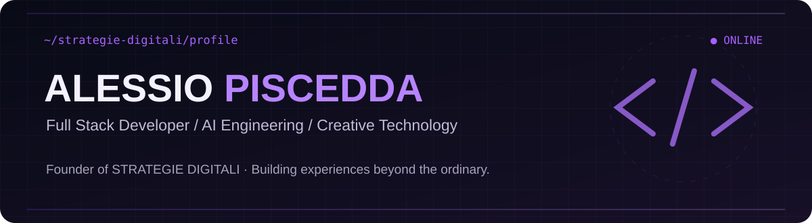
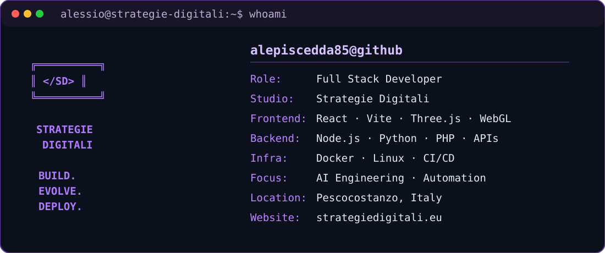

<div align="center">



### Engineering × Design × Artificial Intelligence

**Full Stack Developer · IBM Certified · Founder of [Strategie Digitali](https://www.strategiedigitali.eu)**

[](https://www.strategiedigitali.eu)
[](https://github.com/alepiscedda85)
[](https://www.openstreetmap.org/search?query=Pescocostanzo)

</div>

## `01 / SYSTEM PROFILE`



Ciao, sono **Alessio Piscedda**. Progetto e sviluppo esperienze digitali, applicazioni full stack, integrazioni API, automazioni e sistemi AI-oriented. Con **Strategie Digitali** unisco engineering e direzione creativa: dall'architettura software all'interfaccia, dal repository al deploy.

Mi interessano soprattutto prodotti **performanti, accessibili, manutenibili e realmente utilizzabili**.

## `02 / TECH STACK`

| Area | Tecnologie |
| :--- | :--- |
| **Frontend & 3D** | JavaScript, TypeScript, React, Vite, HTML, CSS, Three.js, WebGL |
| **Backend & APIs** | Node.js, Fastify, Python, Flask, PHP, REST APIs |
| **CMS & Data** | WordPress Headless, PostgreSQL, MongoDB, Redis |
| **DevOps & Cloud** | Git, GitHub Actions, Docker, Linux, VPS, CI/CD |
| **AI & Automation** | AI Engineering, agentic workflows, LLM integrations, automation |

> Stack rappresentativo delle tecnologie e degli ambiti su cui lavoro; non un elenco di certificazioni per ciascun tool.

## `03 / SELECTED WORK`

<table>
<tr>
<td width="50%">

### [Strategie Digitali](https://www.strategiedigitali.eu)

**Creative engineering · WebGL · React**

Esperienze web immersive, branding digitale e sviluppo custom: incontro tra design, 3D e frontend moderno.

</td>
<td width="50%">

### SYNAPSE

**Agent orchestration · Fastify · React**

Piattaforma interna di orchestrazione, integrazioni e policy per i workflow di Strategie Digitali.

*Progetto interno: repository non linkata se privata.*

</td>
</tr>
<tr>
<td width="50%">

### SuperSimple CRM

**CRM · APIs · Automation**

Sistema operativo per prospecting, gestione contatti e workflow commerciali.

*Progetto interno: repository non linkata se privata.*

</td>
<td width="50%">

### [GitHub Portfolio](https://github.com/alepiscedda85?tab=repositories)

**Engineering · Open source · Learning**

Esperimenti tecnici, esercizi e progetti pubblici consultabili direttamente dalle repository disponibili.

</td>
</tr>
</table>

## `04 / LIVE ACTIVITY`

<div align="center">

[](https://github.com/alepiscedda85?tab=followers)
[](https://github.com/alepiscedda85?tab=repositories)

**[→ Esplora il calendario dei contributi e l'attività aggiornata sul mio profilo GitHub](https://github.com/alepiscedda85)**

</div>

I dati dinamici utilizzano endpoint pubblici; non sono mostrati numeri di commit, stelle o righe di codice non verificati. Le repository private non vengono rese pubbliche da questo README.

## `05 / HOW I BUILD`

```text
DISCOVER  →  DESIGN  →  ARCHITECT  →  BUILD  →  TEST  →  DEPLOY  →  ITERATE
```

- **Design-driven engineering:** attenzione a UX, prestazioni e dettagli.
- **Production-first mindset:** codice comprensibile, test, versionamento e deployment controllato.
- **AI as a tool:** integrazioni concrete e automazioni con supervisione e sicurezza.
- **Continuous learning:** formazione e sperimentazione su stack moderni.

## `06 / CERTIFICATIONS & COLLABORATION`

🎓 **IBM Full Stack Software Developer Professional Certificate**

Collaboro con aziende, freelance, agenzie e team su applicazioni, frontend, backend, integrazioni API e prodotti digitali.

<div align="center">

### Have a project in mind?

**[Visit Strategie Digitali →](https://www.strategiedigitali.eu)** · **[Explore my repositories →](https://github.com/alepiscedda85?tab=repositories)**

<sub>Designed with purpose · Built with code · Powered by curiosity</sub>

</div>
